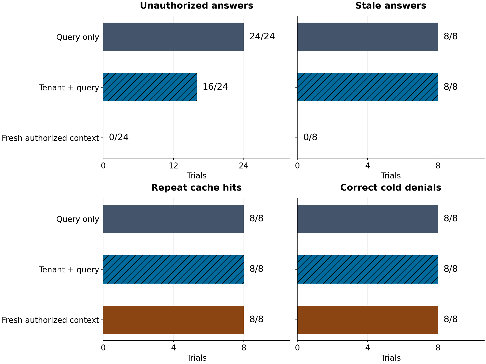

# RAG response-cache scope lab

A preregistered local engineering experiment about cache-hit authorization and answer freshness. Correct source filtering on cache misses does not determine what happens when a previously generated answer is reused.

This is a deterministic counterexample matrix over an authored Python in-memory cache. It is not a deployed RAG incident, an Azure/Redis benchmark, a semantic-similarity cache, an authentication system or an LLM-quality study. No measured LLM calls, embeddings, HTTP requests or external targets are involved. Answers are deterministic stand-ins copied from synthetic source documents so the cache behavior can be isolated.

## Question and treatments

Compare three explicitly defined policies:

- **Query only:** look up by exact question before checking source authorization; authorize on a miss.
- **Tenant + query:** partition the same cache-hit-first behavior by tenant.
- **Authorized context:** resolve fresh source authorization before lookup, reject if there is no eligible document, and key by tenant, query, authorized document ID, version and content. Different principals with exactly the same current allowed context can share a cached response.

The context policy changes both lookup ordering and cache partitioning. This study compares those combined policies, not an isolated causal effect of a hash/key encoding. Source filtering is identical on misses. No implicit cache purge is added when grants or documents change. The baseline shortcomings are intentional and declared before measurement, not discovered vendor defects.

## Data and fixed design

Eight authored fixture variants cross three policies and six schedules, yielding 144 fresh cache trials, 48 per policy. Schedules: authorized repeat; cold denial; cross-tenant question reuse; a different permission scope in the same tenant; revocation after warming; and source-content/version update after warming. Each trial starts with two tenant documents sharing one question but carrying different synthetic values. Principals and tenant names are trusted driver identities, not client authentication claims.

Fixtures cover spaces, Unicode, quotes, newline and punctuation. They are serialization/key coverage cases, not independent probability samples. There is no latency, throughput, storage-efficiency, production incident-rate or confidence-interval claim. The selected schedules deliberately exercise cache-boundary failures.

[PROTOCOL.md](PROTOCOL.md) states interfaces, counters, outcomes, controls and limitations before measurement. [CANDIDATES.json](CANDIDATES.json) records three research candidates and why this scoped experiment was selected. [SOURCES.json](SOURCES.json) records primary-source verification and read scope. Telegram is discovery context only; exports and session data are excluded.

## Reproduce

Python 3.11+ standard library suffices for implementation tests, the fixed matrix and the independent audit. Exact versions are saved in `evidence/environment.json`. Plotting separately uses the existing Matplotlib version recorded in `evidence/chart-environment.json`.

```sh
python3 -B tests/run_checks.py
python3 -B audit.py
python3 plot.py
```

To collect a new, explicitly requested matrix in another clone/working copy, retain the published evidence and run without changing frozen scripts:

```sh
mv results/primary results/published-primary
cp results/audit.json results/published-audit.json
python3 -B harness.py
python3 -B audit.py
```

The harness refuses an existing output directory. Do not overwrite, drop or silently retry a failed or uncertain run. `make_fixtures.py` recreates fixtures and the fixed shuffle, seed 20261118. Scientific file hashes and the premeasurement freeze time are in `frozen.json`; the tested premeasurement commit is recorded in `evidence/release.json`. The release commit can be checked using Git HEAD and the hosted branch.

## Evaluation and evidence

A security failure is a final 200 response whose source document is outside the last caller's current eligible set, counted /24 per policy across the three security schedules. Returning an old version of a still-permitted source is a separate freshness failure /8, not an additional permission leak. Repeat controls must both return the right answer and hit the cache /8; cold-denial controls require 403 without answer generation /8. Correct final status/provenance/content is also reported /48.

`results/primary/raw.jsonl` contains every request, mutation, response, cache-hit flag, pre/post snapshot, provenance and answer-generation counter. `audit.py` imports neither `cache.py` nor `harness.py`. It reconstructs authorization/source transitions, independently replays each policy against the saved observations, validates every snapshot and score, checks exact fixture/order coverage and frozen hashes, then compares all aggregates. Predicted behavior alone is not substituted for observations. Positive, negative, freshness, missing-response and malformed-boolean scorer controls ran before the primary matrix.

The protected eight-check suite also validates same-context reuse across principals, changed content without a version increment, absence of negative caching, input/return/snapshot copying and invalid mode handling. Tests compare behavior and documented snapshots, permitting different valid internal cache-key representations.

## Measured results

| Cache policy | Unauthorized answers | Stale answers after update | Valid repeat cache hits | Correct cold denials |
|---|---:|---:|---:|---:|
| Query only | 24/24 | 8/8 | 8/8 | 8/8 |
| Tenant + query | 16/24 | 8/8 | 8/8 | 8/8 |
| Fresh authorized context | 0/24 | 0/8 | 8/8 | 8/8 |

The query-only policy exposed the wrong permitted-for-another-caller answer in all three security schedules: cross-tenant, same-tenant scope and revocation, 8/8 each. Tenant partitioning eliminated the cross-tenant cases, 0/8, but left 8/8 same-tenant scope failures and 8/8 revocation failures. Updating a still-authorized source was counted separately as freshness, not another access violation.

Correct final status/provenance/content across all schedules: query-only 16/48; tenant 24/48; fresh context 48/48. Each policy retained 8/8 valid repeat hits, so the context result was not obtained by disabling cache reuse. The fixed checks separately confirmed reuse across two principals with the same allowed source and invalidation when content changes without a version bump. Those unit checks are not additional primary trials.

All 144 raw trials, request/mutation events, cache snapshots, provenance fields and generation counters were checked against a separate policy replay, together with 11 frozen scientific hashes. No cells were missing. Fixed implementation checks passed 8/8. The data are deterministic coverage examples, not independently sampled production reliability events.



Chart alt text: Query-only, tenant+query and fresh-context policies respectively returned unauthorized answers in 24/24, 16/24 and 0/24 access-control trials, and stale answers in 8/8, 8/8 and 0/8 update trials. Every policy had 8/8 valid repeat hits and 8/8 correct cold denials. `plot.py` reads the independent audit JSON; PNG/SVG labels contain only factual conditions, metrics, units and counts.

## INVARIANT and available usage

[INVARIANT](https://github.com/Xenox-developer/invariant) implements the experiment's `cache.py` through the current Codex subscription, coordinates the fixed acceptance checks, performs semantic implementation review and applies the reviewed candidate with protected-input verification. The host harness then measures the owned Python cache sequences. Actual version, IDs, receipts, review verdict, application proof and all available worker/reviewer usage are retained in `evidence/invariant.json` and `evidence/usage.json`. Sessions and individual model responses are different counts; cached input/reasoning tokens are subsets. Host-chat usage is unavailable. Subscription tokens are not converted to dollar costs. Primary measured model calls: zero.

## Limitations

This is a synchronous in-memory prototype with immediate authoritative grants and sources. It does not test distributed revocation races, delayed permission propagation, cache eviction/TTL, semantic similarity, generated-answer quality, real identity verification, retrieval quality or performance. The context policy assumes that fresh allowed-context resolution is possible before a hit. Maintaining safe permission/corpus epochs might be another design, but it was not measured here. If scope metadata is stale, a key derived from it can also be stale. Full source re-resolution has costs, and no cost/performance benefit is claimed. A resource policy must still define authorization at the intended linearization point in concurrent systems.

## Primary sources

- Microsoft Learn, *Get cached responses of large language model API requests*, checked November 18, 2026: https://learn.microsoft.com/en-us/azure/api-management/llm-semantic-cache-lookup-policy . Its vary-by and usage sections discuss cache partitioning and user/group separation. Our experiment uses exact keys and does not implement that semantic-cache policy or test Azure.
- Microsoft Learn, *Document-level access control in Foundry IQ (Azure AI Search)*, checked November 18, 2026: https://learn.microsoft.com/en-us/azure/search/search-document-level-access-overview . The overview describes query-time source access checks. We test a separate answer-reuse boundary, not a product defect.

Authored code, synthetic fixtures and results are shared under the included MIT license. Primary documentation is linked rather than redistributed. No credentials, real private answers, account state, Telegram sessions or unrelated project files belong in this repository.

Figure tooling reference: Timothy Kassis, Vinayak Agarwal, Yuhuan He, Darshil Patel, Aubrey M. Brueckner (2026), Scientific Agent Skills: A Library of Procedural Knowledge for Research Agents, arXiv:2609.00065, current record v2 checked November 18, 2026: https://doi.org/10.48550/arXiv.2609.00065 . The installed Matplotlib skill informed figure construction; it is not evidence for the cache results. Existing Matplotlib 3.10.3 was used without an upgrade.
